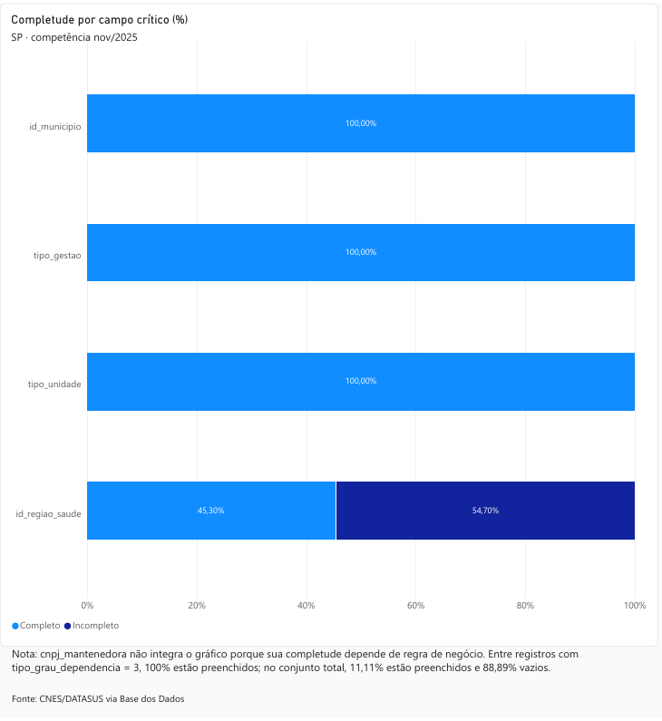

<p align="center">
  
  
  
</p>

# Diagnóstico de Qualidade e Governança de Dados em Estabelecimentos de Saúde (CNES/DATASUS)

**Carla Rodrigues de Moraes** · Nexis — Dados em Saúde · [LinkedIn](https://linkedin.com/in/carla-rodrigues-br) · [GitHub](https://github.com/carla-dados-br)

> Avaliei a qualidade do cadastro oficial de **110.362 estabelecimentos de saúde de São Paulo** (dados públicos do Ministério da Saúde, sem dados de pacientes, competência novembro de 2025), propus regras de governança e preparei os dados para interoperabilidade no padrão FHIR.



### Principais resultados

- **54,7% dos cadastros sem região de saúde.** Uma checagem comum de campo vazio mostraria 0%, porque a ausência está gravada como texto.
- **Até 34 mil valores compatíveis com CPF** num campo público. Tratei o risco de dado pessoal (LGPD) publicando só contagens agregadas.
- **Regra de UTI confirmada pelas portarias do Ministério da Saúde:** 0 de 550 leitos SUS sem habilitação.
- **Revisei a própria análise em uma auditoria**, feita com apoio de IA, e corrigi 3 regras, cada correção registrada e datada.

### Competências aplicadas

Qualidade de dados · Governança de dados · LGPD · SQL (BigQuery) · Python (pandas) · Power BI · Interoperabilidade FHIR R4 · Git

### Para ler em 5 minutos

[Resumo executivo](docs/documento-de-resultados.md#1-resumo-executivo) · [Regras de governança](docs/framework-governanca.md) · [Painéis](dashboard/) · [Todos os achados](#4-achados)

---

## Sumário

1. [Pergunta do projeto](#1-pergunta-do-projeto)
2. [Contexto do processo](#2-contexto-do-processo)
3. [Dados](#3-dados)
4. [Achados](#4-achados)
5. [Método](#5-método)
6. [Regras e validações](#6-regras-e-validações)
7. [Decisões registradas](#7-decisões-registradas)
8. [Limitações](#8-limitações)
9. [Aprendizados e correções de método](#9-aprendizados-e-correções-de-método)
10. [Como reproduzir](#10-como-reproduzir)
11. [Estrutura do repositório](#11-estrutura-do-repositório)
12. [Próximos passos](#12-próximos-passos)
13. [Referências](#13-referências)
14. [Autoria e licença](#14-autoria-e-licença)

---

## 1. Pergunta do projeto

A pergunta central do projeto é:

> Quanto do cadastro está incompleto, inconsistente ou desatualizado, onde esses problemas aparecem e quais controles de qualidade e governança podem reduzir o risco de propagação dessas inconsistências?

### Perguntas de negócio

- Quais campos críticos do cadastro apresentam problemas de completude?
- Existem inconsistências entre informações relacionadas armazenadas em tabelas diferentes?
- Qual o percentual de estabelecimentos sem atualização cadastral recente?
- Existem identificadores duplicados dentro do recorte?
- Como a qualidade do cadastro varia entre municípios?
- Quais achados exigem regras explícitas de governança?
- Quais limitações semânticas precisam ser resolvidas antes de transformar esses dados em recursos interoperáveis?

Cada indicador calculado deve responder a uma necessidade analítica ou de governança identificável.

**Resposta curta.** O identificador dos estabelecimentos é único, mas mais da metade dos cadastros não informa a região de saúde, um em cada cinco não registra alteração no cadastro há mais de 24 meses e, nos leitos de UTI do SUS, toda categoria cadastrada tem a habilitação correspondente.

---

## 2. Contexto do processo

O CNES é uma base estrutural para diferentes processos de informação em saúde. Problemas cadastrais podem se propagar para análises, integrações, indicadores e processos que dependem desses registros.

---

## 3. Dados

Este projeto utiliza dados públicos do CNES (Cadastro Nacional de Estabelecimentos de Saúde), disponibilizados pelo DATASUS/Ministério da Saúde e acessados inicialmente pelo dataset público `br_ms_cnes` da Base dos Dados, para avaliar a qualidade cadastral de estabelecimentos de saúde.

### Recorte

| Item | Descrição |
|---|---|
| Geográfico | Estado de São Paulo |
| Temporal | competência de novembro de 2025 |
| Fonte analítica principal | Base dos Dados |
| Dataset | `br_ms_cnes` |
| Consulta | Google BigQuery |

O recorte principal contém **110.362 estabelecimentos**.

A justificativa completa do recorte está documentada em [`docs/decisao-recorte.md`](docs/decisao-recorte.md).

---

## 4. Achados

O [documento de resultados](docs/documento-de-resultados.md) consolida os 10 achados (A1 a A10), com evidência, prioridade, recomendações e limitações. Abaixo, um resumo dos principais.

### Resultados em números

| Resultado | Número | O que significa |
|---|---|---|
| Região de saúde ausente, gravada como texto `"nan"` | 60.366 (54,70%) | Uma verificação com `IS NULL` mostraria 0%. A ausência varia de 0% a 99,18% entre 347 municípios. |
| Cadastros sem alteração há mais de 24 meses | 22.868 (20,72%) | Critério do projeto. Não equivale à regra de desativação da Portaria SAS/MS nº 118/2014. |
| Valores de `cpf_cnpj` compatíveis com CPF | até 34.318 de 98.559 | Risco de dado pessoal em base pública; o projeto publica só contagens agregadas. |
| Habilitações com ano `9999` no lugar da data final | 6.072 de 6.764 (89,77%) | Isolado o valor sentinela, 0 habilitações vencidas. |
| Leitos de UTI do SUS sem habilitação correspondente | 0 de 550 | O de-para do projeto coincide com as Portarias SAES/MS nº 2.902/2025 e nº 3.511/2025. |
| Tipo de estabelecimento sem significado oficial | código `16`, 5 estabelecimentos | Já presente na origem do DATASUS; exportado ao FHIR sem rótulo inventado. |
| Identificadores CNES duplicados | 0 de 110.362 | O código CNES funciona como chave única no recorte. |

### Ausência mascarada em `id_regiao_saude`

O campo `id_regiao_saude` não representa ausência apenas com `NULL`.

Foram identificadas três formas:

- `NULL`;
- texto literal `"nan"`;
- string vazia `""`.

Uma verificação baseada apenas em `IS NULL` produziria falsamente 0% de incompletude.

Após a comparação entre SQL e Python e a inclusão das três formas de ausência, a métrica corrigida do recorte é **54,70% de incompletude**.

Esse achado mostra que a forma física de representação do dado precisa ser investigada antes da definição de métricas.

### Valor sentinela em habilitações

Na tabela `habilitacao`, o valor:

```text
ano_competencia_final = 9999
```

aparece nos registros sem data final definida e é interpretado pelo projeto como prazo final indeterminado; essa interpretação não foi verificada junto à fonte. O mês associado não é fixo: `99` em 6.068 registros e `9` em 4 (ver etapa 7 de `sql/04-consistencia-habilitacao-vencida.sql`).

No recorte, **6.072 de 6.764 habilitações (89,77%)** utilizam esse padrão.

A regra de habilitação vencida precisou excluir explicitamente o sentinela antes da comparação temporal. Após o tratamento correto, **0 habilitações vencidas** foram encontradas no recorte.

### Comparação entre leitos e habilitações

A primeira versão da regra somava a quantidade de leitos de todas as habilitações e encontrou divergência em 768 de 768 estabelecimentos. A auditoria de 02/11/2026 mostrou que 464 deles só tinham habilitações sem leitos, o que tornava a divergência inevitável.

Restrita às habilitações que têm leitos (18 dos 191 tipos), a comparação abrange **304 estabelecimentos**. Em relação aos leitos SUS:

```text
299 com mais leitos SUS do que habilitados
  4 com o mesmo número
  1 com mais leitos habilitados do que leitos SUS
```

A diferença no primeiro sentido é esperada, porque o total de leitos inclui tipos que não dependem de habilitação. O único caso a investigar é o estabelecimento com mais leitos habilitados do que leitos SUS.

### UTI: correspondência entre leitos e habilitações

Foram avaliadas **1.103 combinações estabelecimento + categoria de UTI**, em 547 estabelecimentos. Com todos os leitos, **553 (50,1%)** não apresentaram habilitação correspondente segundo o de-para do projeto.

Com os **leitos SUS**, para os quais a correspondência é definida pelas Portarias SAES/MS nº 2.902/2025 e nº 3.511/2025, o resultado muda:

```text
550 combinações com leitos SUS
  0 sem habilitação correspondente
```

As 553 combinações sem habilitação são exatamente as que têm 0 leitos SUS, em 298 estabelecimentos. O de-para do projeto coincide com a tabela oficial nas categorias que ela cobre.

### Completude não garante consistência semântica

O campo `tipo_unidade` apresentou:

- 0 `NULL`;
- 0 textos `"nan"`;
- 0 strings vazias.

Portanto, apresentou **0% de incompletude** no recorte.

Entretanto, a investigação do domínio mostrou que completude física não significa necessariamente consistência semântica.

Foram observados **38 códigos distintos**, dos quais:

- 37 possuem correspondência na tabela `dicionario`;
- o código `16` não possui correspondência nessa fonte;
- 5 estabelecimentos apresentam `tipo_unidade = 16`.

Em uma validação terminológica separada da Fase 6, os mesmos 38 códigos observados foram comparados com o ValueSet `BRTipoEstabelecimentoSaude` consultado. Desses, 37 aparecem entre os 39 conceitos da versão terminológica registrada em `sql/16-validacao-tipo_unidade-terminologia-fhir.sql`; novamente, o único código observado ausente é o `16`. Os conceitos `32` e `64` pertencem ao ValueSet consultado, mas não aparecem no recorte SP/2025-11.

Como o artefato terminológico consultado é posterior ao snapshot de novembro de 2025, a ausência do código `16` nessa versão não prova que ele nunca tenha possuído significado oficial no período histórico analisado.

Isso transformou o código `16` em uma exceção semântica que precisou ser investigada antes do mapeamento FHIR.

### Investigação de proveniência do código `tipo_unidade = 16`

A investigação temporal mostrou que o código `16` começou a aparecer recentemente nos cinco estabelecimentos afetados do recorte, substituindo diferentes códigos anteriores.

Também foi identificada ocorrência nacional do código em múltiplas UFs a partir de setembro de 2025 dentro do período pesquisado.

Para verificar se o valor poderia ter sido criado durante a transformação da Base dos Dados, foi realizado um teste independente de proveniência.

**Ferramentas utilizadas**

- Docker;
- PySUS 2.11.1;
- fonte CNES consultada com `source="origin"`.

**Consulta realizada**

```text
Estado: SP
Ano: 2025
Mês: 11
Grupo CNES: ST
```

O conjunto retornado apresentou:

- 110.362 registros;
- 208 colunas;
- campos originais `CNES` e `TP_UNID`.

Os cinco estabelecimentos investigados apresentaram:

| CNES | `TP_UNID` |
|---|---:|
| `4932609` | `16` |
| `5767032` | `16` |
| `5828953` | `16` |
| `9340459` | `16` |
| `9570365` | `16` |

Resultado: **5 de 5 registros apresentaram `TP_UNID = 16` na origem consultada.**

Portanto, não foi encontrada evidência de que a transformação observada entre a origem consultada e a Base dos Dados tenha introduzido o valor `16`.

> [!IMPORTANT]
> Isso mostra que o valor já estava presente na origem consultada, mas não confirma seu significado semântico. O código continua sem significado oficial confirmado dentro das fontes utilizadas no projeto.
>
> Por essa razão, `tipo_unidade = 16` não é exportado como `Coding` nesta versão. Sem significado semântico e sistema terminológico validados, não serão atribuídos `system`, `code` ou `display`.

Investigação completa: [`docs/investigacao-proveniencia-tipo-unidade-16.md`](docs/investigacao-proveniencia-tipo-unidade-16.md).

### Tempo sem alteração cadastral

Foi adotada uma janela metodológica de **24 meses** anteriores à própria competência do snapshot (novembro de 2025), e não à data em que a análise foi executada.

| Última alteração registrada | Estabelecimentos |
|---|---:|
| Nos últimos 24 meses | 87.494 |
| Há mais de 24 meses | 22.868 (20,72%) |
| Há mais de 6 meses (inclui os anteriores) | 50.785 (46,02%) |
| Não informada | 0 |

> [!IMPORTANT]
> A Portaria SAS/MS nº 118/2014 manda desativar estabelecimentos há mais de 6 meses sem atualização cadastral, mas define atualização como a transmissão da base local para a nacional, mesmo sem mudança nos dados. O campo usado pelo projeto indica a última alteração do cadastro. Por isso, o indicador mede tempo sem alteração, e não o descumprimento dessa regra. A janela de 24 meses é critério do projeto.

### Distribuição regional

A incompletude de `id_regiao_saude` apresenta forte variação municipal.

Foram avaliados **347 municípios** com pelo menos 20 estabelecimentos.

| Faixa de incompletude | Municípios |
|---|---:|
| 0–25% | 100 |
| 25–50% | 67 |
| 50–75% | 111 |
| 75–100% | 69 |

A hipótese inicial de uma distribuição bimodal foi testada e rejeitada. O problema apresenta distribuição contínua entre municípios.

### Unicidade

O campo `id_estabelecimento_cnes` foi avaliado dentro do recorte fixo SP + novembro/2025.

Resultado:

```text
110.362 registros
0 identificadores duplicados
```

Dentro deste recorte, `id_estabelecimento_cnes` funciona como chave única de fato.

---

## 5. Método

O trabalho percorre diferentes etapas do ciclo de vida do dado:

- exploração e compreensão da estrutura;
- definição de recorte;
- avaliação de completude;
- avaliação de consistência;
- avaliação de atualidade;
- avaliação de unicidade;
- tratamento e reprodução dos indicadores em Python;
- visualização dos resultados;
- definição de regras mínimas de governança;
- investigação de proveniência;
- preparação para interoperabilidade por meio de FHIR.

A Fase 6 avalia campos selecionados do CNES para interoperabilidade FHIR R4. A implementação aprovada nesta versão gera `Organization` com identificador CNES e CEP em `Organization.address.postalCode`; `Location` foi considerado no escopo inicial, mas não é gerado como recurso independente. Cinco exemplos JSON possuem registro de validação formal FHIR R4 (4.0.1).

### Dimensões de qualidade

O diagnóstico utiliza quatro dimensões fixas de qualidade.

| Dimensão | O que mede | Status |
|---|---|---|
| Completude | Presença dos valores esperados considerando regras reais de preenchimento | 5 campos avaliados |
| Consistência | Contradições, incompatibilidades ou problemas de domínio entre campos e tabelas | 3 regras principais + investigação semântica |
| Atualidade | Tempo desde a última alteração cadastral | Concluída |
| Unicidade | Existência de duplicidade de identificadores dentro do recorte | Concluída |

As quatro dimensões possuem ao menos um indicador calculado e documentado.

### Tratamento em Python (Fase 2)

A Fase 2 reproduziu formalmente parte dos indicadores originalmente desenvolvidos em SQL utilizando Python e pandas.

Notebook principal: [`python/fase2-limpeza-tratamento.ipynb`](python/fase2-limpeza-tratamento.ipynb).

A reprodução das três regras de consistência e do indicador de atualidade em Python não foi feita e está registrada como limitação (documento de resultados, seção 7.3).

### Dashboard (Fase 4)

A Fase 4 produziu três visualizações principais:

- completude por campo;
- atualidade cadastral;
- distribuição regional.

Os relatórios foram produzidos no Power BI e os resultados exportados e versionados na pasta `dashboard/`.

A versão Web do Power BI utilizada no projeto exigiu relatórios separados para algumas visualizações devido às limitações de combinação de múltiplas fontes sem o Power BI Desktop.

### Interoperabilidade FHIR (Fase 6)

A **Fase 6 está tecnicamente concluída**. A revisão corretiva reconciliou a documentação, reexecutou a suíte automatizada e revalidou os cinco exemplos FHIR R4.

O objetivo é avaliar informações selecionadas do CNES para representação compatível com **FHIR R4**. O escopo inicial considerou `Organization` e `Location`; após a revisão semântica, a implementação desta versão permaneceu restrita a `Organization`, com o CEP em `Organization.address.postalCode` e sem `Location` independente.

O processo não consiste apenas em renomear colunas. Cada campo precisa ser avaliado considerando:

- conceito de origem;
- significado semântico;
- recurso FHIR apropriado;
- elemento FHIR;
- cardinalidade;
- tipo de dado;
- sistema de identificação ou terminologia;
- necessidade de transformação;
- referências entre recursos;
- possível perda semântica.

Os mapeamentos foram classificados como:

- direto;
- aproximado;
- dependente de transformação;
- sem correspondência clara.

A investigação de `tipo_unidade = 16` foi realizada justamente porque um código cuja semântica não está confirmada não pode ser transformado automaticamente em um conceito FHIR validado.

As entregas de encerramento da Fase 6 foram concluídas e auditadas:

- definição do mapeamento;
- geração dos recursos;
- produção de exemplos JSON;
- validação formal FHIR;
- documentação das perdas e exceções semânticas.

> [!NOTE]
> Submissão de dados à RNDS não faz parte do escopo deste projeto.

### Status do projeto

As 7 fases estão concluídas: exploração e recorte; tratamento em Python; indicadores de qualidade; dashboard; governança; mapeamento e validação FHIR; consolidação dos resultados.

<details>
<summary><b>Atividades da Fase 6 (FHIR)</b></summary>

- [x] investigação inicial dos campos disponíveis para interoperabilidade;
- [x] avaliação de `id_estabelecimento_cnes` como identificador;
- [x] investigação do domínio de `tipo_unidade`;
- [x] identificação da exceção semântica `tipo_unidade = 16`;
- [x] análise temporal dos cinco estabelecimentos afetados;
- [x] análise nacional da ocorrência do código `16`;
- [x] teste de proveniência utilizando PySUS e `source="origin"`;
- [x] documentação formal da exceção semântica;
- [x] concluir tabela de mapeamento CNES → FHIR;
- [x] implementar transformação;
- [x] gerar recursos `Organization`;
- [x] avaliar o uso de `Location` e decidir por não gerar recurso independente nesta versão;
- [x] validar formalmente os recursos FHIR;
- [x] documentar perdas semânticas e exceções.

</details>

<details>
<summary><b>Checklist técnico concluído</b></summary>

- [x] Ambiente configurado e BigQuery Sandbox utilizado
- [x] Estrutura da tabela `estabelecimento` explorada
- [x] 204 colunas identificadas na tabela analítica principal
- [x] Recorte definido e validado contra dados reais
- [x] Estrutura do conjunto investigada
- [x] 14 tabelas avaliadas quanto a chaves e granularidade
- [x] Escopo revisado após exploração da estrutura
- [x] Completude de `id_regiao_saude` calculada e corrigida para 54,70%
- [x] Completude de `tipo_unidade` calculada: 0% de ausência
- [x] Domínio observado de `tipo_unidade` investigado: 37 de 38 códigos reconciliados com a tabela `dicionario`
- [x] Cobertura terminológica FHIR verificada: 37 de 38 códigos observados aparecem no `BRTipoEstabelecimentoSaude` consultado; o código `16` é a única exceção observada
- [x] Exceção semântica do código `16` documentada
- [x] Regra de habilitação vencida
- [x] Investigação da divergência entre quantidades de leitos e habilitações
- [x] Correspondência entre leitos de UTI do SUS e habilitações verificada
- [x] Indicador de atualidade cadastral
- [x] Indicador de distribuição regional
- [x] Completude de `id_municipio`
- [x] Completude de `tipo_gestao`
- [x] Completude condicional de `cnpj_mantenedora`
- [x] Indicador de unicidade
- [x] Pipeline formal em Python
- [x] Comparação SQL × Python
- [x] Dashboard produzido
- [x] Framework de governança produzido
- [x] Investigação de proveniência do código `16`
- [x] Mapeamento CNES → FHIR concluído
- [x] Recursos FHIR gerados
- [x] Recursos FHIR formalmente validados

</details>

---

## 6. Regras e validações

### Verificações de consistência e investigações aplicadas

Foram implementadas três verificações principais, escolhidas para representar diferentes níveis de complexidade analítica. Nos cruzamentos entre `leito` e `habilitacao`, os resultados são tratados como achados para investigação enquanto a relação semântica e a regra de negócio esperada não estiverem formalmente confirmadas.

| Verificação / investigação | Tabelas | O que avalia | Status |
|---|---|---|---|
| Habilitação com competência final vencida ainda registrada | `habilitacao` | comparação temporal dentro da própria tabela | Concluída |
| Comparação agregada entre quantidades de leitos e habilitações | `leito` + `habilitacao` | diferença observada entre medidas agregadas, sem pressupor equivalência semântica | Concluída |
| Correspondência entre leitos de UTI e habilitações | `leito` + `habilitacao` | correspondência por categoria de UTI, com leitos SUS, conforme as Portarias SAES/MS nº 2.902/2025 e nº 3.511/2025 | Concluída |

A correspondência entre tipos de leito e tipos de habilitação foi investigada separadamente, pois os dois campos utilizam domínios de códigos diferentes.

### Governança de dados (Fase 5)

A Fase 5 transformou os principais achados técnicos em regras mínimas de governança.

O framework contém **10 regras de governança**, cada uma associada a um problema efetivamente encontrado durante o projeto.

Documento: [`docs/framework-governanca.md`](docs/framework-governanca.md).

O framework diferencia explicitamente:

```text
fato confirmado
≠
hipótese
≠
regra metodológica do projeto
```

Essa separação evita transformar interpretações ainda não verificadas em regras de negócio ou afirmações sobre a fonte.

---

## 7. Decisões registradas

As decisões de escopo, tratamento e interpretação são registradas em `docs/`.

Sempre que possível, cada decisão contém:

- problema encontrado;
- evidência;
- interpretação;
- hipótese, quando existente;
- decisão adotada;
- justificativa;
- impacto sobre as etapas posteriores.

Uma decisão sem justificativa escrita reduz a auditabilidade e dificulta a reprodução da análise.

O projeto também preserva a separação entre:

```text
observação
hipótese
conclusão
decisão metodológica
```

Uma hipótese plausível não é documentada como fato enquanto não houver evidência suficiente para sustentá-la.

---

## 8. Limitações

### Escopo da análise

O projeto mede a qualidade do cadastro, não a qualidade operacional ou assistencial das instituições.

Um estabelecimento com cadastro completo não é necessariamente bem administrado, assim como um cadastro incompleto não demonstra má gestão da instituição.

### Recorte geográfico e temporal

O diagnóstico principal utiliza São Paulo, competência novembro de 2025.

Os resultados desse snapshot não devem ser automaticamente generalizados para todo o Brasil ou para outras competências.

Investigações nacionais ou temporais realizadas durante o projeto são utilizadas como análises auxiliares e ficam explicitamente identificadas.

### Defasagem da fonte

O snapshot analisado representa uma competência específica da base.

Resultados relacionados à atualidade são calculados em relação à própria competência de novembro de 2025 para garantir reprodutibilidade.

### Dados pessoais

O projeto utiliza dados de estabelecimentos. Nenhum dado de paciente é utilizado.

O conjunto `br_ms_cnes` contém uma tabela `profissional` com informações pessoais de profissionais de saúde. Essa tabela permanece fora do escopo, e nenhum dado dela é extraído ou versionado neste repositório.

A revisão da Fase 6 também identificou risco de privacidade dentro da própria tabela `estabelecimento`: o campo `cpf_cnpj` contém valores que passam matematicamente pelos algoritmos de CPF e/ou CNPJ. Essa validação não comprova existência cadastral, titularidade nem tipo fiscal efetivo do documento.

Por precaução, valores individuais de `cpf_cnpj` não são publicados nem versionados. As evidências do projeto permanecem agregadas, conforme `sql/15-validacao-cpf_cnpj.sql` e a Regra 10 de `docs/framework-governanca.md`. O campo também não é convertido em identificador CPF/CNPJ nos recursos FHIR desta versão.

### Proveniência

O uso de `source="origin"` no PySUS permite reduzir camadas intermediárias durante a investigação da proveniência.

Entretanto, confirmar que determinado valor existe no conjunto disponibilizado pela origem consultada não significa determinar em qual sistema ou processo anterior ele foi originalmente criado.

### Semântica

A presença de um código nos dados não é suficiente para atribuir significado a ele.

O código `tipo_unidade = 16` exemplifica essa diferença:

```text
presença na origem consultada
≠
semântica validada
```

Nenhum significado terminológico será inventado para preencher lacunas durante a transformação FHIR.

### FHIR

O projeto realiza mapeamento e validação de recursos FHIR.

Não envolve submissão à RNDS.

Integração produtiva com a RNDS exigiria requisitos operacionais, de segurança, autenticação e credenciamento que estão fora do escopo deste projeto de portfólio.

### Convenções metodológicas

Alguns critérios utilizados no projeto, como a janela de 24 meses para avaliação de atualidade, são decisões metodológicas próprias.

Eles não são apresentados como normas do DATASUS quando não existe confirmação documental para isso.

---

## 9. Aprendizados e correções de método

A comparação SQL × Python permitiu identificar e corrigir divergências reais de interpretação, incluindo:

- tipo correto de `id_municipio`;
- existência de strings vazias em `id_regiao_saude`;
- correção da métrica de incompletude de 54,69% para 54,70%.

A auditoria de 02/11/2026 levou a três correções de método, registradas com nota datada no log e nas consultas:

- a comparação entre leitos e habilitações passou a usar só as habilitações que têm leitos (`sql/05`, etapas 6 a 8);
- a regra de UTI passou a ser calculada com leitos SUS, para os quais a correspondência oficial é definida (`sql/06`, etapa 10);
- o indicador de atualidade passou a ser lido como tempo sem alteração cadastral, depois da consulta à Portaria SAS/MS nº 118/2014 (`sql/08`, etapa 6).

---

## 10. Como reproduzir

O projeto utiliza ambientes diferentes conforme a etapa executada.

### Tecnologias

SQL · Google BigQuery · Python · pandas · Power BI · Git · GitHub · Docker · PySUS · FHIR R4

### SQL — Google BigQuery

As consultas estão em `sql/` e utilizam o conjunto público `basedosdados.br_ms_cnes`.

Recorte principal: São Paulo, novembro de 2025.

Para reproduzir os indicadores, abra o BigQuery, execute o arquivo SQL correspondente e compare o resultado com a documentação do projeto.

### Python — Google Colab

O notebook principal está em `python/fase2-limpeza-tratamento.ipynb`.

Ele foi executado no Google Colab, com autenticação Google e acesso ao BigQuery.

As dependências utilizadas estão registradas em `requirements.txt`.

**Ambiente de referência**

| Pacote | Versão |
|---|---|
| Python | 3.13.16 |
| pandas | 2.2.3 |
| numpy | 2.1.3 |
| google-cloud-bigquery | 3.44.0 |
| db-dtypes | 1.7.1 |

> Python 3.13.16 foi verificado diretamente no ambiente Google Colab durante a revisão corretiva de 2026-10-05; essa verificação caracteriza o ambiente observado nessa revisão e não atribui retroativamente a mesma versão a execuções anteriores do notebook.

O identificador do projeto Google Cloud é uma configuração do ambiente do usuário e deve ser ajustado antes da execução.

### Proveniência — Docker e PySUS

A investigação de `tipo_unidade = 16` é complementar à análise principal.

Foi executada separadamente com:

| Ferramenta | Versão |
|---|---|
| Docker | versão não registrada na execução |
| Python | 3.12 |
| PySUS | 2.11.1 |

Os detalhes estão em [`docs/investigacao-proveniencia-tipo-unidade-16.md`](docs/investigacao-proveniencia-tipo-unidade-16.md).

### FHIR R4 — Fase 6

O mapeamento e as decisões de exclusão estão em `docs/mapeamento-cnes-fhir.md`. O conversor `python/fase6-conversor-fhir.py` gera um `Bundle` do tipo `collection` com `Organization.identifier.value` (CNES) e `Organization.address.postalCode` (CEP). Os demais campos analisados não são exportados nesta versão.

Para gerar um exemplo a partir de um par CNES/CEP, execute na raiz do repositório:

```bash
python3 python/fase6-conversor-fhir.py --cnes 0003735 --cep 07144000 --saida /tmp/bundle-cnes-reproducao.json
```

Como restrições de entrada desta implementação, o conversor exige CNES com exatamente 7 dígitos e CEP com exatamente 8 dígitos. Essas verificações são estruturais e não constituem, por si só, uma afirmação normativa universal sobre os identificadores.

A validação estrutural não comprova que um CNES e um CEP informados pela CLI pertencem ao mesmo registro da fonte. Essa correspondência deve ser validada a montante. Para os cinco exemplos versionados, os pares foram reproduzidos em `sql/14-proveniencia-exemplos-fhir.sql`.

O caminho de saída deve estar disponível: o conversor não sobrescreve arquivos existentes. O `fullUrl` da `Organization` utiliza `uuid5` determinístico derivado do sistema identificador CNES e do próprio CNES, permitindo reprodução estável do mesmo recurso.

Os testes automatizados podem ser executados com `python3 -m unittest discover -s tests -p 'test_*.py' -v`. Na revisão corretiva de 2026-10-05, os 13 testes de `tests/test_fase6_conversor_fhir.py` foram aprovados.

Para validar o JSON gerado, utilize o FHIR Validator CLI 6.10.4 com Java 17 ou superior:

```bash
java -Xmx2g -jar /caminho/validator_cli-6.10.4.jar /tmp/bundle-cnes-reproducao.json -version 4.0.1 -tx n/a
```

O caminho `/tmp/bundle-cnes-reproducao.json` é apenas um destino temporário de exemplo. O caminho do arquivo `validator_cli-6.10.4.jar` deve ser ajustado ao ambiente local.

Os cinco Bundles em `fhir/exemplos/` passaram na validação com FHIR Validator CLI 6.10.4 e FHIR R4 (4.0.1): 5/5 aprovados, com 0 erros e 0 avisos. A evidência consolidada está em `fhir/validacao/validacao-cinco-bundles-cnes.log`.

A validação abrange somente os cinco exemplos e as regras FHIR R4 verificadas. O parâmetro `-tx n/a` desativa a consulta a um servidor terminológico externo. Os resultados não comprovam conformidade com perfis específicos da RNDS nem representam a validação de todos os 110.362 registros do recorte CNES.

### Dados locais

Extrações locais em CSV, Parquet e bancos temporários não são versionadas. O `.gitignore` também protege arquivos de ambiente, credenciais e artefatos temporários.

Arquivos JSON não são ignorados globalmente porque a Fase 6 inclui exemplos de recursos FHIR em JSON.

---

## 11. Estrutura do repositório

**Principais entregas**

- [Documento de resultados](docs/documento-de-resultados.md): resumo executivo, 10 achados com evidência, 11 recomendações e limitações.
- [Framework de governança](docs/framework-governanca.md): 10 regras, cada uma ligada a um achado.
- [Dashboard](dashboard/): três painéis em PDF (completude, atualidade e distribuição regional).
- [Mapeamento CNES → FHIR R4](docs/mapeamento-cnes-fhir.md), [conversor](python/fase6-conversor-fhir.py) e [5 exemplos validados](fhir/exemplos/) (0 erros, 0 avisos).
- [19 consultas SQL](sql/) e o [registro de cada consulta](docs/log-de-queries.md).

```text
.
├── sql/
│   ├── 01-exploracao-fase1.sql
│   ├── 02-verificacao-estrutura.sql
│   ├── 03-completude-id_regiao_saude.sql
│   ├── 04-consistencia-habilitacao-vencida.sql
│   ├── 05-consistencia-divergencia-leitos.sql
│   ├── 06-consistencia-uti-sem-habilitacao.sql
│   ├── 07-completude-tipo_unidade.sql
│   ├── 08-atualidade-cadastral.sql
│   ├── 09-distribuicao-regional.sql
│   ├── 10-completude-id_municipio.sql
│   ├── 11-completude-tipo_gestao.sql
│   ├── 12-completude-cnpj_mantenedora.sql
│   ├── 13-unicidade-id_estabelecimento_cnes.sql
│   ├── 14-proveniencia-exemplos-fhir.sql
│   ├── 15-validacao-cpf_cnpj.sql
│   ├── 16-validacao-tipo_unidade-terminologia-fhir.sql
│   ├── 17-validacao-relacao-cnpj-mantenedora.sql
│   ├── 18-validacao-transicoes-natureza-juridica-2022.sql
│   └── 19-validacao-historico-tipo-unidade-16.sql
│
├── docs/
│   ├── documento-de-resultados.md
│   ├── log-de-queries.md
│   ├── decisao-recorte.md
│   ├── achados-verificacao-estrutura.md
│   ├── dicionario-de-dados.md
│   ├── framework-governanca.md
│   ├── investigacao-proveniencia-tipo-unidade-16.md
│   ├── mapeamento-cnes-fhir.md
│   └── projeto-portfolio-cnes-qualidade-dados-v2.md
│
├── python/
│   ├── fase2-limpeza-tratamento.ipynb
│   └── fase6-conversor-fhir.py
│
├── tests/
│   └── test_fase6_conversor_fhir.py
│
├── dashboard/
│   └── relatórios e evidências da Fase 4
│
├── fhir/
│   ├── exemplos/ (5 Bundles JSON)
│   └── validacao/ (1 log consolidado)
│
├── .gitignore
├── LICENSE
├── requirements.txt
└── README.md
```

---

## 12. Próximos passos

O projeto foi concluído na Fase 7. Os próximos passos recomendados, que não fazem parte desta versão, estão na seção 8 do [documento de resultados](docs/documento-de-resultados.md):

1. validar junto à fonte as interpretações ainda não confirmadas (ano `9999`, significado de `habilitacao.quantidade_leitos` e código `16`);
2. testar a origem do texto `"nan"` na região de saúde;
3. pilotar os controles de menor custo em uma nova competência;
4. repetir a medição em outra competência;
5. reconstruir e versionar o teste de proveniência com PySUS.

---

## 13. Referências

Referências citadas na documentação do projeto.

**Dados**

- Base dos Dados. Conjunto `br_ms_cnes` (Cadastro Nacional de Estabelecimentos de Saúde), consultado no Google BigQuery. https://basedosdados.org
- Ministério da Saúde. SCNES — Guia de Preenchimento. https://wiki.saude.gov.br/cnes/index.php/SCNES_-_Guia_de_Preenchimento

**Normas**

- Brasil. Ministério da Saúde. Portaria GM/MS nº 1.646, de 2 de outubro de 2015. Institui o Cadastro Nacional de Estabelecimentos de Saúde (CNES). https://bvsms.saude.gov.br/bvs/saudelegis/gm/2015/prt1646_02_10_2015.html
- Brasil. Ministério da Saúde. Portaria de Consolidação GM/MS nº 1/2017, que incorpora a Portaria nº 1.646/2015.
- Brasil. Ministério da Saúde. Secretaria de Atenção à Saúde. Portaria SAS/MS nº 118, de 18 de fevereiro de 2014 (republicada). Desativação automática, no SCNES, de estabelecimentos há mais de 6 meses sem atualização cadastral. https://bvsms.saude.gov.br/bvs/sas/Links%20finalizados%20SAS%202014/prt0118_12_06_2014_rep.html (acesso em 02/11/2026)
- Brasil. Ministério da Saúde. Portaria de Consolidação SAES/MS nº 1/2022 (citada em `docs/mapeamento-cnes-fhir.md`).
- Brasil. Ministério da Saúde. Portaria SAES/MS nº 2.902, de 26 de junho de 2025. Exclui as habilitações 26.02, 26.05 e 26.97 e vincula os leitos 81 e 82 às habilitações 26.10 e 26.11. https://www.editoraroncarati.com.br/v2/Diario-Oficial/Diario-Oficial/PORTARIA-SAES-MS-N%C2%BA-2-902-DE-26-06-2025.html (acesso em 02/11/2026)
- Brasil. Ministério da Saúde. Portaria SAES/MS nº 3.511, de 24 de novembro de 2025. Define o registro no CNES e a habilitação de leitos de UTI e UCI. https://ses.sp.bvs.br/wp-content/uploads/2025/12/U_PT-MS-SAES-3511_241125.pdf (acesso em 02/11/2026)
- Brasil. Lei nº 14.195, de 26 de agosto de 2021. https://www.planalto.gov.br/ccivil_03/_ato2019-2022/2021/lei/l14195.htm
- DREI. Ofício Circular SEI nº 4856/2022. https://www.gov.br/empresas-e-negocios/pt-br/drei/legislacao/arquivos/oficios-circulares-drei/2022/SEI_30141120_Oficio_Circular_4856.pdf

**Padrões e terminologias**

- HL7. FHIR R4 (4.0.1) — Organization. https://hl7.org/fhir/R4/organization.html
- HL7. FHIR R4 (4.0.1) — Data Types. https://hl7.org/fhir/R4/datatypes.html
- Ministério da Saúde. ValueSet `BRTipoEstabelecimentoSaude`, versão 1.1.0. https://terminologia.saude.gov.br/fhir/ValueSet/BRTipoEstabelecimentoSaude
- Ministério da Saúde. NamingSystem CNES. https://terminologia.saude.gov.br/fhir/NamingSystem/cnes
- RNDS. CodeSystem `BRNaturezaJuridica`. https://rnds-fhir.saude.gov.br/CodeSystem-BRNaturezaJuridica.html
- IBGE/CONCLA. Tabela de Natureza Jurídica 2021 — Notas Explicativas. https://concla.ibge.gov.br/images/concla/documentacao/CONCLA-TNJ2021-NotasExplicativas.pdf

**Ferramentas**

- PySUS 2.11.1. https://github.com/AlertaDengue/PySUS
- FHIR Validator CLI 6.10.4 (HL7), usado na validação dos cinco exemplos FHIR R4.

---

## 14. Autoria e licença

### Licença e uso dos dados

O código e a documentação autoral deste repositório são disponibilizados sob a licença MIT. Consulte o arquivo `LICENSE`.

Os dados utilizados nas análises são provenientes do CNES/DATASUS e foram acessados principalmente por meio da Base dos Dados. Esses dados não são relicenciados por este repositório e permanecem sujeitos aos termos, licenças e condições definidos pelas respectivas fontes.

### Autoria

**Carla Rodrigues de Moraes**

Profissional em formação em Dados para Saúde · Biomedicina + Ciência de Dados e IA

As decisões de escopo, tratamento, qualidade, governança e interoperabilidade deste projeto são documentadas para tornar o processo reproduzível e auditável.

**Autoria e apoio de IA:** este projeto foi idealizado, desenvolvido e executado pela autora, com auxílio de IA generativa como ferramenta de apoio: aprendizagem, orientação técnica, revisão, auditoria e apoio na redação de textos e scripts. A IA não executou o projeto de forma autônoma nem substituiu a decisão da autora: as consultas foram executadas por ela, e todas as análises, correções, decisões e textos publicados foram conferidos e aprovados por ela.

[LinkedIn](https://linkedin.com/in/carla-rodrigues-br) · [GitHub](https://github.com/carla-dados-br)
